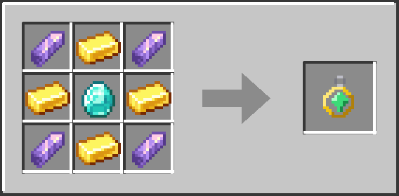

# Repair Talisman

**Download:** [repairtalisman-1.0.1.jar](https://github.com/lordstudmuffin/repair-talisman/raw/main/releases/repairtalisman-1.0.1.jar)

One craftable talisman that slowly repairs every damaged item you carry: hotbar, main inventory, armor and offhand.
Standalone and lightweight: it needs only Fabric Loader. No Fabric API, no library mods, no Trinkets.

- Minecraft **26.1.x** (built and tested against 26.1.2 signatures), **Fabric Loader 0.18.0 or newer**, Java 25 (the
  version 26.1 already needs).
- Works in singleplayer and on servers (install on both sides, like any item mod).
- License: MIT.

## Crafting

Shaped, 3x3 crafting table:

Text version: `A G A / G D G / A G A` with A = Amethyst Shard, G = Gold Ingot, D = Diamond.

The recipe appears in the recipe book (and EMI / REI / JEI when present) once you have picked up a diamond.

## What it does

Every 3 seconds (60 ticks) the talisman restores 1 durability point on every damaged item in the holding player's
inventory, including the hotbar, armor slots and offhand. It works from any inventory slot, it is unbreakable, it is
fire resistant (it survives lava) and it glows like an enchanted item. Carrying more than one talisman does not stack:
only the first one found in the inventory does the repairing.

The talisman repairs tools, weapons, armor, elytra, shields, fishing rods, flint and steel, shears and any modded item
that has durability. Items marked Unbreakable are skipped. It does not repair items in chests, backpacks, bundles or
Trinkets/Accessories charm slots, because those are not inventory slots.

## Config

`config/repairtalisman.properties` is written with the defaults on first launch:

| key            | default | meaning                                                               |
|----------------|---------|-----------------------------------------------------------------------|
| intervalTicks  | 60      | ticks between repair pulses (20 ticks = 1 second)                     |
| repairAmount   | 1       | durability points restored per damaged item per pulse                 |
| onlyInHotbar   | false   | if true, the talisman only works while it sits in the hotbar          |
| repairArmor    | true    | repair the four armor slots                                           |
| repairOffhand  | true    | repair the offhand slot                                               |

Edit the file and restart the game. The tooltip on the talisman shows the configured rate. On a server the server's file decides the real rate; a client with a different file only shows a different tooltip.

## Installation

1. Install Fabric Loader for Minecraft 26.1.2 (the Fabric installer, or "Create custom profile" in the CurseForge app
   with Fabric as the loader and 26.1.2 as the version).
2. Drop `repairtalisman-1.0.1.jar` into the `mods` folder. Nothing else is required.

## Changelog

- **1.0.1** (2026-10-27): fixes a crash on launch when Fabric API is not installed ("Registry is already frozen"): the talisman is now registered just before vanilla freezes its registries. Also skips its own resource-pack hook when Fabric API's resource loader is present, and adds source/issue links for Mod Menu. 1.0.0 only worked with Fabric API installed; replace it.
- **1.0.0** (2026-10-19): first release.

## How it is built

No Gradle. The jar is compiled with plain `javac` against signature stubs of Minecraft 26.1 and Fabric Loader, then
packed with `jar` (see docs/BUILD.md). Three small mixins make the
mod standalone: one registers the item before vanilla freezes its registries, one exposes the jar's own assets/data to
the game, and one adds the talisman to the Tools & Utilities creative tab (all three are normally Fabric API's job). The repair logic itself uses only vanilla's per-tick `Item.inventoryTick` hook.
